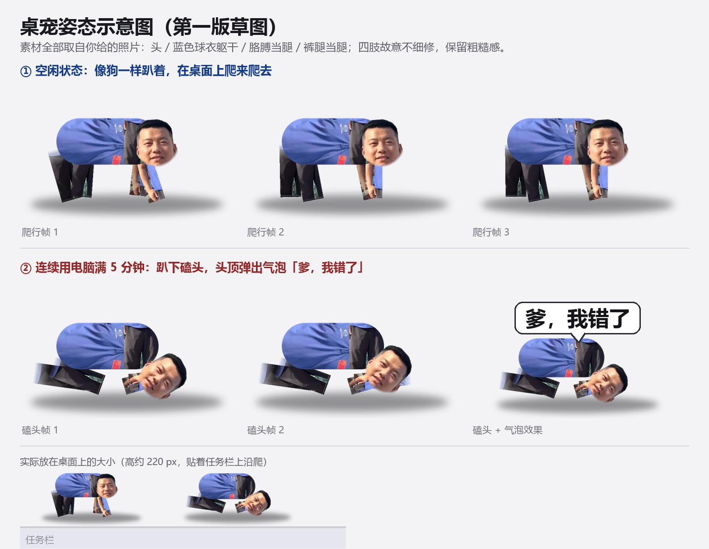
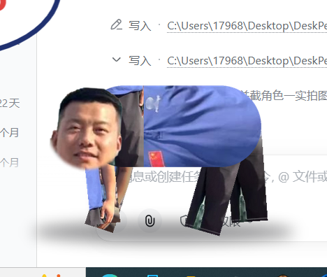

# DeskPet · 会磕头的桌宠

> A tiny desktop pet that crawls on all fours — and kowtows to you after 5 minutes of non-stop computer use.

一个趴在 Windows 桌面底部爬来爬去的小人：**空闲时像狗一样爬**，**连续用电脑满 5 分钟就趴下磕头**，头顶冒出气泡「爹，我错了」。

素材全部来自一张真人照片（头 / 衣服 / 胳膊 / 裤腿重新拼装），四肢故意不细修，保留粗糙的拼贴感。





---

## ✨ 特性

- **两个状态**：`爬行`（4 帧对角步态，在桌面底部来回爬）/ `磕头`（3 帧，配合气泡）
- **连续使用检测**：用系统级 `GetLastInputInfo` 判断「连续在用电脑」，满 5 分钟触发磕头，离开 30 秒自动清零
- **逐像素透明窗口**：`WS_EX_LAYERED` + `UpdateLayeredWindow`，边缘柔和；**透明区域鼠标穿透**，不挡桌面操作
- **托盘 + 任务栏**：托盘图标常驻（双击收起/叫出），任务栏有独立按钮
- **右键菜单**：动作（爬来爬去 / 磕一个 / 连磕三个 / 原地休息 / 掉个头）、暂停、收起、置顶、开机自启、退出
- **左键拖动**、**单实例**、**DPI 感知**（125% 缩放不错位）
- **绿色单文件 exe**：不联网、不写系统目录、不安装任何东西
- **兼容 Windows 7 SP1 32 位**：用系统自带 .NET Framework 3.5 + `csc.exe` 编译成 x86 单文件，运行时仅依赖 Win7 自带运行时

## 🚀 快速开始

### 直接运行

1. 下载仓库根目录的 `DeskPet.exe`（也可以从 Releases 下载，或自己编译，见下）；
2. 双击运行，宠物出现在屏幕底部开始爬；
3. 右键它或托盘图标 → 菜单。

> 想看磕头效果又不想等 5 分钟：`DeskPet.exe --dev`（阈值缩短为 15 秒）。

### 自己编译

Windows 上双击 `build.bat`（不需要装 Visual Studio，用的是系统自带的 `csc.exe`）：

```
build.bat        →  build\DeskPet.exe
```

脚本会自动查找 `%WINDIR%\Microsoft.NET\Framework\` 下的编译器（优先 v3.5，其次 v2.0/v4.0）。

## 🖥 系统要求

| 项目 | 要求 |
|---|---|
| 系统 | Windows 7 SP1 及以上（32/64 位均可运行 x86 exe） |
| 运行时 | .NET Framework 3.5（Win7 自带；若未启用：控制面板 → 程序和功能 → 启用或关闭 Windows 功能 → 勾选 .NET Framework 3.5） |
| 其它 | 无。无第三方库、无安装包 |

## 🖱 使用说明

| 操作 | 效果 |
|---|---|
| 左键拖动 | 拖着宠物走 |
| 右键宠物 / 托盘图标 | 打开菜单（同一套） |
| 双击托盘图标 | 收起 / 叫出宠物 |
| 任务栏按钮的最小化 | 收起宠物（不会变成白框） |

菜单项：

```
动作 ▸ 爬来爬去（默认）/ 磕一个 / 连磕三个 / 原地休息 / ─── / 掉个头
暂停爬行
收起桌宠
始终置顶 ✔
开机自启 ☐
退出桌宠
```

## ⌨️ 命令行参数

| 参数 | 说明 |
|---|---|
| `--dev` | 调试模式：连续使用阈值 5 分钟 → **15 秒**，且忽略空闲判定 |
| `--debug` | 写日志到 `%TEMP%\DeskPet.log` |
| `--selftest` | 不开窗口，只把渲染结果存成 `%TEMP%\deskpet_selftest_*.png`（验证素材） |

## 🔧 自定义

| 想改什么 | 改哪里 |
|---|---|
| 磕头间隔 / 连续判定阈值 | `src/PetForm.cs` → `FiveMinutes`（默认 300000 ms）、`IdleReset`（默认 30000 ms） |
| 气泡文字 | `src/Sprites.cs` → `MakeBubble("爹，我错了")` |
| 爬行速度 / 步态帧率 | `src/PetForm.cs` → `MoveCrawl()` 里的 `45f + random`、`_walkPhase += dt * 8f` |
| 宠物大小 | `tools/build_sprites.py` → `H_PX`（默认 260），重新生成帧并编译 |
| 显示名 | `assets/petname.txt`（窗口标题 / 菜单文字） |

## 🎨 素材是怎么来的

素材由 Python 从一张照片离线生成（运行桌宠**不需要** Python，脚本只在改图时用）：

```
assets/source.jpg
   │  tools/cutout.py        GrabCut 抠像 + 白底处理
   ▼
build/cutout.png
   │  tools/rig.py           拆件（头/衬衫/胳膊/腿）→ 参数化关节拼成狗爬 & 磕头
   ▼
assets/sprites/crawl_0..3.png + kowtow_0..2.png     ← tools/build_sprites.py 统一裁切导出
assets/sprites/icon.ico                             ← tools/make_icon.py（头像 → 圆角 ico）
```

依赖：`pip install pillow opencv-python numpy`

```bat
python tools\cutout.py
python tools\build_sprites.py
python tools\make_icon.py
build.bat
```

## 📁 目录结构

```
DeskPet/
├─ build.bat                一键编译（输出 build\DeskPet.exe）
├─ src/                     C# 源码（C# 3.0 / .NET 3.5）
│   ├─ Program.cs           入口、单实例、日志、自检、显示名
│   ├─ Native.cs            Win32 互操作（分层窗口、空闲检测、DIBSection）
│   ├─ Sprites.cs           帧加载 / 镜像 / 合成 / 预乘 alpha / 气泡
│   └─ PetForm.cs           窗口、状态机、托盘、菜单、命中测试
├─ assets/
│   ├─ source.jpg           原始照片
│   ├─ portrait.jpg         头像（做图标）
│   ├─ petname.txt          显示名
│   └─ sprites/             成品帧 + icon.ico（编译时嵌入 exe）
├─ tools/                   Python 素材脚本
└─ docs/                    预览图 / 截图
```

## 🧠 实现要点

- **透明窗口**：`WS_EX_LAYERED` 窗口 + `UpdateLayeredWindow`，每帧把 ARGB 位图转成预乘 BGRA 后写入 `CreateDIBSection` 的内存 DC，无需 `unsafe`。
- **鼠标穿透**：`WM_NCHITTEST` 里按当前帧 alpha 判断，透明像素返回 `HTTRANSPARENT`，点击直接落到下层窗口。
- **连续使用判定**：每秒查一次 `GetLastInputInfo`；两次输入间隔 < 30 秒视为连续，累计满 5 分钟后触发磕头并清零；锁屏/离开自动重置。
- **状态机**：`Crawl`（随机方向 + 速度 + 偶尔停顿）↔ `Kowtow`（4.6 秒动画 + 气泡淡入淡出）→ 回到 `Crawl`。
- **单实例**：按 exe 文件名生成 Mutex 名，所以不同角色的 exe 可以同时运行。

## ⚠️ 已知限制

- 只在**主屏**活动（`Screen.PrimaryScreen`），多显示器需要小改。
- 磕头判定把看视频、打游戏也算「在用电脑」，介意的话可调 `IdleReset`。
- 素材来自真人照片，仅作演示；想换成自己的照片，替换 `assets/source.jpg` 后重跑 `tools/` 脚本即可。

## 🔒 隐私

程序不联网、不读取任何文件内容、不写注册表（除非你勾选「开机自启」，会写 `HKCU\Software\Microsoft\Windows\CurrentVersion\Run`）。

## 📄 License

代码以 [MIT](LICENSE) 许可发布。照片素材来源于作者提供的照片，随仓库仅作示例用途。
